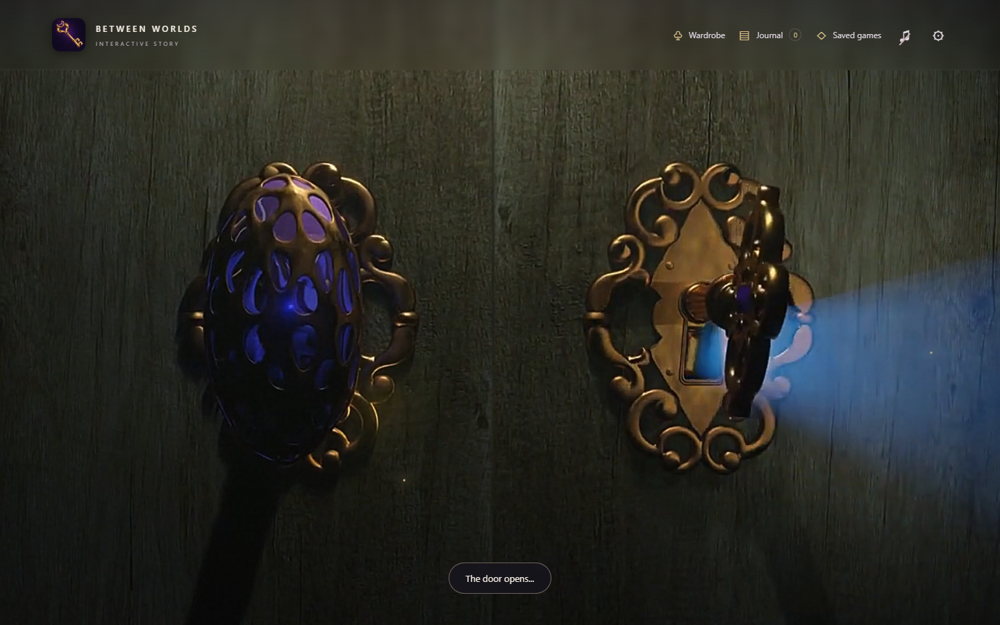
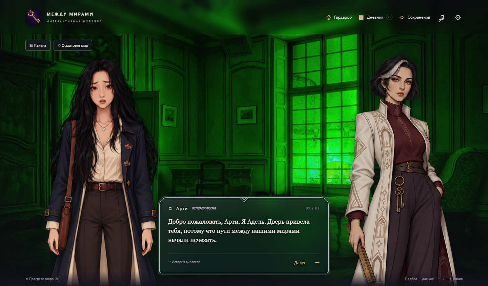
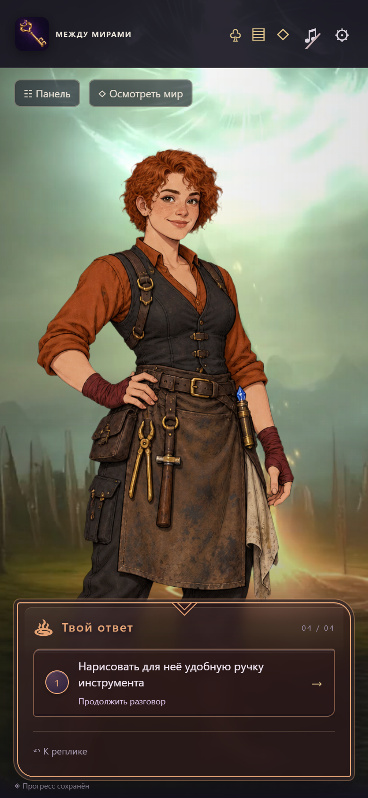

<div align="center">

# ✦ Between Worlds
### Shards of the Key · an interactive fantasy story
**One door. Ten encounters. A choice only you can make.**

  

[The story](#-the-story) · [Screenshots](#-screenshots) · [Play locally](#-play-locally) · [Flutter edition](https://github.com/Arty1909/Between-Worlds-Flutter)

</div>



## ✧ The story

*Between Worlds: Shards of the Key* is an offline visual novel about a heroine who steps through a mysterious door and discovers that the paths between worlds are disappearing. Meet the guardians, collect the key's shards, solve their trials, and decide where your journey ends. A playthrough takes roughly **40–60 minutes**.

The prologue leads into six chapters and four possible endings. Choices affect courage, trust, relationships, dialogue, and the routes available at the end. Three dialogue challenges and a moon-symbol puzzle add playable moments to the story. Twelve everyday-life scenes explore what staying in another world might actually mean.

## ✨ What you can do

| Feature | In the game |
| --- | --- |
| 🗝️ Branching narrative | Meet ten guardians, answer their questions, build relationships, and discover four endings. |
| 📖 Journal | Revisit clues and dialogue, inspect characters, and follow relationship progress. |
| 👗 Wardrobe | Try four complete heroine looks and inspect portraits up close. |
| 🌍 Explore | Pan and zoom illustrated scenes with the 2.5D camera. |
| 🎵 Atmosphere | Twelve looping instrumental themes, world effects, and optional animated backgrounds. |
| 💾 Saves | Automatic progress plus three manual slots for trying different paths. |
| 📱 Responsive play | Desktop and mobile browser layouts, with compact video assets for small screens. |
| 🌐 Languages | English, Russian, Spanish, Italian, and French dictionaries. |

## 📸 Screenshots

<table><tr><td width="65%"></td><td width="35%"></td></tr><tr><td align="center">A conversation between worlds</td><td align="center">A choice on mobile</td></tr></table>

<details><summary><strong>🧭 How a journey unfolds</strong></summary>

1. Name your heroine and enter the first door.
2. Talk with the guardians and make choices that shape trust and courage.
3. Gather clues in the journal, face dialogue trials, and solve the lighthouse puzzle.
4. Decide whether to return home, stay, join the worlds, or follow an unknown route.

</details>

## ▶️ Play locally

You need **Python 3.10+** and a modern browser with MP4 support. There are no pip packages to install and gameplay does not require internet access.

```bash
python main.py
```

On macOS or Linux, `./start.sh` or `./start.command` can launch the same server. On Windows, use `Запустить игру.bat` or the command above. The game opens in your default browser; if it does not, use the local address printed in the terminal. Keep the terminal open while playing. For a fixed port without opening a browser automatically:

```bash
python main.py --no-browser --port 8765
```

Open the game through the local server, rather than opening `web/index.html` as a file. The server runs story actions, saves progress, and serves video with seek support.

### Controls

`Space` / `Enter` advances dialogue · `1`–`4` chooses an answer · `J` opens the journal · `S` opens saves · `M` toggles music · `F` toggles fullscreen · `Esc` closes a dialog. The camera also supports mouse or touch dragging and zoom controls.

## 🧩 How it is built

The browser interface lives in `web/` (JavaScript, HTML, CSS). `main.py` starts the local HTTP server; `engine.py` handles game state, actions, puzzles, and saves. `story.py`, `story_expansion.py`, and `story_edition3.py` define the narrative. `assets/`, `materials/`, and `New folder (2)/` contain runtime media. `android/` contains source for the offline Android adapter. `hosting/` contains an optional PHP hosting adaptation.

Saves are created locally in `saves/` and are excluded from this repository. Run automated checks with:

```bash
python -m unittest discover -s tests -v
node tests/test_music.cjs
node tests/test_camera.cjs
node tests/test_background.cjs
node tests/test_arrivals.cjs
```

The [Flutter edition](https://github.com/Arty1909/Between-Worlds-Flutter) brings the same story to a native Flutter interface.

## ⚖️ License and media

The **source code** is available under the [MIT License](LICENSE). Artwork, character portraits, screenshots, video, music, and other media are **not licensed under MIT**. See [Media rights](MEDIA_RIGHTS.md) before copying or redistributing media. Third-party components retain their own licenses.
